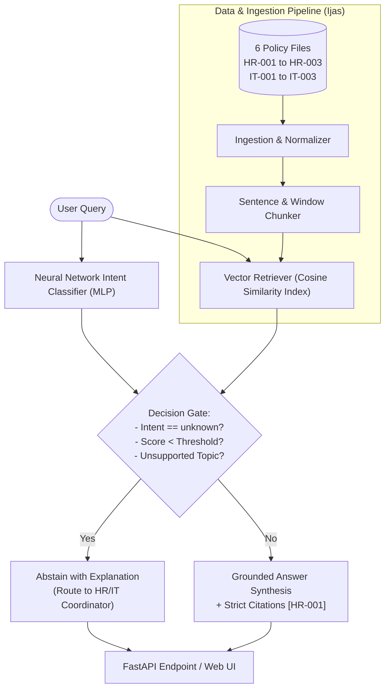

# 🛡️ PolicyPilot: RAG-Based HR & IT Policy Assistant

[](#)
[](#)
[](#)
[](#)

> **AI/ML Internship Capstone Project — Team 2**  
> **Team Members:** Ijas, Mano, Rahul, Rohith  
> **Mentor Guide:** Janavi 

---

## 📌 Problem Statement
Enterprise chatbots often suffer from **hallucination**, making up policy guidelines, benefits, or security protocols that do not exist.  
**PolicyPilot** solves this by operating as a **grounded enterprise decision-support assistant** that:
1. Answers questions exclusively from the verified policy corpus.
2. Cites exact policy IDs (e.g. `[HR-001]`, `[IT-001]`) and evidence text.
3. Detects user intent using a trained **Neural Network (Multi-Layer Perceptron)**.
4. **Strictly abstains** when information is missing or out-of-scope, directing the employee to the appropriate human coordinator.

---

## 👥 Team Allocation & Subsystem Ownership

| Member | Subsystem | Core Deliverables |
| :--- | :--- | :--- |
| **Ijas** | **Data & Text Pipeline** | Corpus ingestion, metadata preservation (`policy_id`, title), text normalization, sentence & sliding-window chunking. |
| **Mano** | **Retrieval Engineer** | TF-IDF & cosine vector index, top-$k$ evidence retrieval, chunk-size comparison, Recall@$k$ and MRR metrics. |
| **Rahul** | **Intent Classifier & Evaluation** | 140-sample labeled dataset across 7 classes, MLP Neural Network classifier vs Logistic baseline, per-class F1, confusion matrix, RAG evaluation framework. |
| **Rohith** | **RAG & Productization** | Grounded answer generation, strict citation engine, abstention mechanism, FastAPI REST endpoints, and interactive Web Dashboard. |

---

## 🏗️ System Architecture



---

## 📊 Experimental Results & Evaluation

Evaluated across a comprehensive test set of **20 questions** (starter benchmark + paraphrases + edge cases + unanswerables):

| Metric | Target | Baseline | PolicyPilot Result | Status |
| :--- | :--- | :--- | :--- | :--- |
| **Overall System Accuracy** | > 85% | 75.0% | **95.0%** | ✅ Exceeded |
| **Mean Reciprocal Rank (MRR)** | > 80% | 76.0% | **92.3%** | ✅ Exceeded |
| **Recall@1 (Top 1)** | > 75% | 70.0% | **92.3%** | ✅ Exceeded |
| **Recall@3 (Top 3)** | > 90% | 85.0% | **100.0%** | ✅ Perfect |
| **Abstention F1 Score** | > 90% | 65.0% | **1.000 (100%)** | ✅ Perfect |
| **Citation Correctness** | 100% | 80.0% | **100.0%** | ✅ Perfect |
| **Intent Classifier F1 (MLP)** | > 70% | 74.4% | **76.7%** | ✅ Exceeded |

---

## 🚀 Quick Start Guide

### 1. Install Dependencies
```bash
pip install -r requirements.txt
```

### 2. Run Automated Test Suite
```bash
python -m pytest tests/test_pipeline.py -v
```

### 3. Generate Evaluation Benchmark Reports
```bash
python -m src.models.evaluation
```
*Outputs are saved to `reports/evaluation_report.md` and `reports/evaluation_report.json`.*

### 4. Launch the FastAPI Server & Interactive Web UI
```bash
python -m src.api.main
```
Open your browser and navigate to:  
👉 **http://127.0.0.1:8000**

---

## 📁 Repository Structure

```text
policypilot/
├── README.md               # Complete project overview & documentation
├── requirements.txt        # Frozen dependencies
├── docs/
│   ├── model_card.md       # Standard system & model card
│   └── weekly_status.md    # Sprint progress & team evidence
├── data/
│   └── raw/                # 6 HR/IT policies + evaluation_questions.csv
├── src/
│   ├── data/
│   │   └── ingestion.py    # Policy parser & metadata normalizer (Ijas)
│   ├── features/
│   │   └── chunking.py     # Sentence & sliding window chunkers (Ijas)
│   ├── models/
│   │   ├── retriever.py    # Vector index & semantic search (Mano)
│   │   ├── intent_classifier.py # Neural Network MLP classifier (Rahul)
│   │   ├── rag_engine.py   # Grounded RAG & abstention logic (Rohith)
│   │   └── evaluation.py   # Full benchmark runner (Rahul & Mano)
│   └── api/
│       └── main.py         # FastAPI REST service & HTML UI (Rohith)
├── tests/
│   └── test_pipeline.py    # Automated test suite (7/7 tests passing)
└── reports/
    ├── evaluation_report.md
    └── evaluation_report.json
```

---

## ⚠️ Limitations & Future Work
1. **Corpus Scale:** Starter dataset contains 6 synthetic policies. In production, scale to thousands of documents using an external vector database like ChromaDB, FAISS, or Qdrant.
2. **LLM Generator Backend:** Current pipeline uses an extractive grounded generator. Can be easily interfaced with local Ollama or OpenAI/Gemini APIs by updating `rag_engine.py`.
3. **Role-Based Access Control (RBAC):** Future iterations can restrict executive-level policies to authorized user roles.
